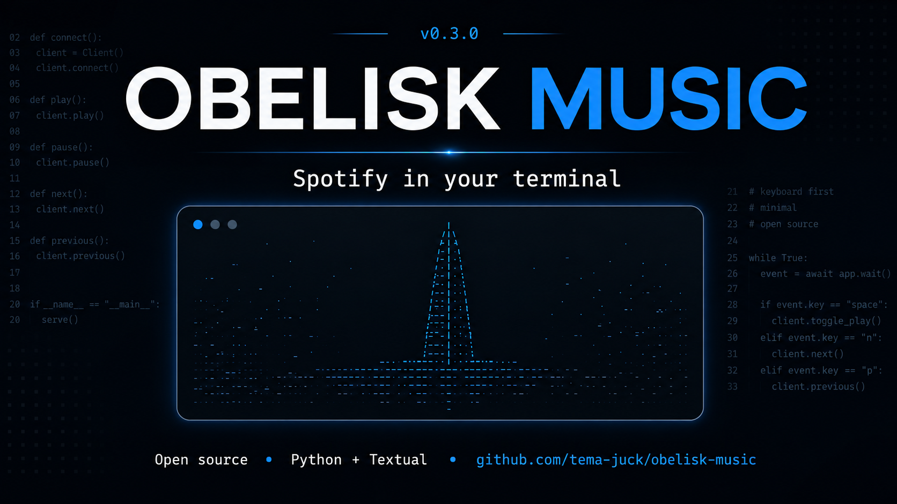

# Obelisk monorepo

One repository containing **two independently packaged applications**. There is
no combined executable, shared playback controller, or cross-product launcher.

| Product | Purpose | Executable | Status |
| --- | --- | --- | --- |
| **Obelisk Player** | Spotify Connect controller | `obelisk` | Published; existing installation remains compatible |
| **Obelisk Radio** | Local Internet Radio through external mpv | `obelisk-radio` | Development; publication blocked pending policy review |

Player stays at the repository root (`obelisk-music`, `obelisk_music`). Radio has
its own package, lockfile, tests, configuration, state, CI, and release validation
under [`apps/radio`](apps/radio). Neither application imports the other.

To develop Radio without installing Player or keyring:

```sh
uv sync --directory apps/radio --frozen --dev
uv run --directory apps/radio obelisk-radio
```

Install [mpv separately](https://mpv.io/installation/) for radio playback. Radio
starts offline in Favorites; `/` searches, `g` browses genres, and `a` adds a public
direct MP3/AAC stream. No Spotify account, credentials, or Premium is needed.
Radio is not included in the published Player binaries or the Player installer.

See the [Radio guide](apps/radio/README.md) and [monorepo architecture and release
policy](docs/monorepo.md). Separate packaging does **not** establish Spotify policy
compliance. This change enables no Radio release publication.

The following installation and Spotify documentation applies to **Obelisk Player**.

<p align="center">
  
</p>

<p align="center">
  <strong>Obelisk Player</strong><br>
  A keyboard-first terminal music player.<br>
  Control Spotify from your terminal with a fast, minimalist interface.
</p>

<p align="center">
  <a href="https://github.com/tema-juck/obelisk-player/actions/workflows/ci.yml"></a>
  <a href="https://github.com/tema-juck/obelisk-player/releases"></a>
  <a href="#installation"></a>
  <a href="pyproject.toml"></a>
  <a href="LICENSE"></a>
  <a href="https://hub.xerj.org/contributors/tema-juck"></a>
</p>

<p align="center">
  <a href="#quick-start">Quick start</a> ·
  <a href="#see-obelisk-player-in-action">Showcase</a> ·
  <a href="docs/README.md">Documentation</a> ·
  <a href="https://github.com/tema-juck/obelisk-player/releases">Releases</a>
</p>

## Your music, within reach

Search Spotify, browse playlists, explore albums and artists, and control playback
without leaving the terminal. Obelisk Player pairs a quiet, borderless Textual
interface with keyboard navigation and a persistent Now Playing strip.

**Playback uses Spotify Connect.** Audio plays through Spotify Desktop or another
controllable Connect device. Obelisk Player sends playback commands through the
Spotify Web API; it does not stream or decode Spotify audio.

> **Alpha software.** The current published prerelease is
> [v0.3.0-alpha.2](https://github.com/tema-juck/obelisk-player/releases/tag/v0.3.0-alpha.2).
> Playback requires Spotify Premium, your own Spotify Developer app, and a Connect
> device. Account permissions, market availability, and Spotify API quotas apply.

## See Obelisk Player in Action

> **A terminal session, coming soon.**
>
> The upcoming screencast will walk through search → album → playback, keyboard
> navigation, and device selection. Until then, explore the
> [music experience guide](docs/music-experience.md) for the current flows.

<!-- Maintainer: add docs/assets/obelisk-demo.gif, then replace the placeholder
above with the following HTML. Keep this commented until the GIF exists.
<p align="center">
  
</p>
-->

## Features

| Area | Available today |
| --- | --- |
| Playback | Spotify Connect play/pause, previous/next, and selected-track playback |
| Authentication | OAuth 2.0 PKCE, automatic token refresh, OS keychain storage |
| Global search | Debounced, paginated search across tracks, albums, and artists |
| Discovery | Album tracks, artist albums, and links to Spotify |
| Library | Paginated playlists and tracks, session caches, unavailable-item feedback |
| Navigation | Arrow keys, optional Vim keys, pane switching, help and search overlays |
| Now Playing | Track, artist, album, device, and locally interpolated progress |
| Appearance | Dark blue `midnight` and monochrome `mono` themes |
| Layout | Responsive browsing and overlays, including compact 40×12 terminals |
| Devices | Spotify Connect device selection and playback transfer |

Followed playlists can appear while their tracks remain inaccessible under
Spotify's API restrictions. See [behavior and limitations](docs/music-experience.md).

## Installation

Standalone executables include Python and runtime dependencies.

| Platform | Release target |
| --- | --- |
| macOS · Apple Silicon | `darwin-arm64` |
| macOS · Intel | `darwin-amd64` |
| Linux · Intel/AMD 64-bit, glibc | `linux-amd64` |

Linux builds use Ubuntu 22.04 as the glibc baseline; Alpine/musl is unsupported.
Older macOS versions are not verified. Windows, Linux ARM64, Homebrew, and PyPI
installation are not provided.

Download the installer, inspect it, then run it:

```sh
curl --fail --location --proto '=https' --proto-redir '=https' --output install.sh https://raw.githubusercontent.com/tema-juck/obelisk-player/main/scripts/install.sh
less install.sh
sh install.sh --prerelease
```

There is no stable release yet. `--prerelease` selects the newest published release
including prereleases; plain `sh install.sh` selects the latest stable release.
Pin the current release with `sh install.sh --version v0.3.0-alpha.2`.

The default destination is `${XDG_BIN_HOME:-$HOME/.local/bin}`. Use
`--bin-dir "$HOME/bin"` for another user-owned directory. If needed, add the default
location to your shell configuration:

```sh
export PATH="$HOME/.local/bin:$PATH"
```

The installer verifies `SHA256SUMS` before installing and never uses sudo or runs
the downloaded executable. Re-run it to upgrade an unchanged managed installation.
For manual downloads, checksum verification, macOS signing limitations,
uninstallation, and troubleshooting, see the [installation guide](docs/installation.md).

## Quick Start

After [installing `obelisk`](#installation):

1. Create your own app in the [Spotify Developer Dashboard](https://developer.spotify.com/dashboard)
   with Web API access. Register `http://127.0.0.1:8765/callback` exactly and permit
   your Spotify account to use the app in Development Mode.
2. Initialize configuration and set `spotify.client_id` to the app's public Client ID:

   ```sh
   obelisk config init
   obelisk config edit
   obelisk config validate
   ```

3. Open Spotify Desktop or another Connect device and start a track.
4. Launch the player, then press **l** to authorize in your browser:

   ```sh
   obelisk
   ```

Return to the terminal after authorization. Press **d** to select a device and
**/** to search. No client secret is needed. Existing `SPOTIFY_CLIENT_ID` setups
continue to work; `.env` files are not loaded automatically.

## Keyboard Shortcuts

Bindings follow the current application, library, and catalog screens. Letter
shortcuts are lowercase unless shown otherwise; **A** means Shift+a.

| Key | Action | Context |
| --- | --- | --- |
| ↓ / ↑ · j / k | Next / previous item | Lists; Vim keys are configurable |
| Enter | Open playlist, album, artist / play selected track | Lists and results |
| Tab / Shift+Tab | Switch pane or search focus | Library and catalog |
| Escape | Back / close overlay | Browsing and dialogs |
| / | Search Spotify / refocus search input | Library / catalog results |
| F1 / F2 / F3 | Search tracks / albums / artists | Search overlay |
| a / A | Open selected track's album / first credited artist | Library and catalog results |
| Space | Play / pause | Library and catalog results |
| n / p | Next / previous track | Library and catalog results |
| d | Select a Spotify Connect device | Library and catalog results |
| l | Authorize Spotify | Library |
| r | Refresh playback and current view | Library; current list in catalog/devices |
| ? | Show keyboard help | Library and catalog results |
| q | Quit the player | Library and catalog results |

Enter on **Load more…** fetches the next page. In the search input, Down, Enter,
or Tab focuses results; typing does not trigger playback shortcuts. Device and
help dialogs use **Escape** or **q** to close; Enter transfers to the selected
controllable device. Navigation alone never starts playback.

## Configuration

Run `obelisk config path` to find the configuration file:

- Default: `~/.config/obelisk/config.toml` on macOS and Linux.
- With `XDG_CONFIG_HOME`: `$XDG_CONFIG_HOME/obelisk/config.toml`; the base must be
  an absolute path without `..` components.

```toml
[spotify]
client_id = "your_client_id_here"
refresh_interval = 8

[appearance]
theme = "midnight"

[interface]
vim_keys = true
```

Choose **`midnight`** for dark blue or **`mono`** for monochrome. Restart after
editing. Precedence is **environment overrides → configuration file → defaults**;
the file must still have valid syntax and schema. Supported overrides are
`SPOTIFY_CLIENT_ID`, `OBELISK_REFRESH_INTERVAL`, `OBELISK_THEME`, and
`OBELISK_VIM_KEYS`. `SPOTIFY_REDIRECT_URI` separately overrides the OAuth callback.

`config init` never overwrites existing files. Refresh tokens remain in the OS
keychain under the compatibility service name `obelisk-music`; keep tokens and
client secrets out of TOML. The [configuration guide](docs/configuration.md)
covers validation, permissions, editor selection, and environment behavior.

## Architecture & Tech Stack

```text
Textual UI + async workers
        ↓
SpotifyLibrary · SpotifySession · SpotifyClient
        ↓
Spotify Web API → Spotify Connect device → audio
```

Python 3.11+, Textual/Rich, HTTPX, Pydantic v2, and `keyring` form the runtime.
Textual workers keep network operations asynchronous; UI widgets emit intents.
The session layer coordinates PKCE, token refresh, and shared request cooldowns.
The library layer owns pagination and caches; playback commands are serialized.

Explore the [source](src/obelisk_music/), [music experience](docs/music-experience.md),
[design system](DESIGN.md), and [UX contract](UX-CONTRACT.md).

## Development

Use [uv](https://docs.astral.sh/uv/) with Python 3.11 or newer. CI checks Python
3.13 and 3.14 on Ubuntu and macOS.

```sh
git clone https://github.com/tema-juck/obelisk-player.git
cd obelisk-player
uv sync --frozen --dev
uv run obelisk
```

Run the project checks and build packages:

```sh
uv run ruff check .
uv run ruff format --check .
uv run pytest -q
shellcheck scripts/install.sh scripts/uninstall.sh
uv build
uv run python scripts/smoke_wheel.py dist/obelisk_music-0.3.0a2-py3-none-any.whl
```

Tests mock Spotify and block real network, browser, and keychain access. The wheel
smoke checks a clean installation outside the checkout. See
[development](docs/development.md) and [release engineering](docs/releasing.md)
for CI parity, native builds, and publication gates.

**Compatibility:** public branding is Obelisk Player. The `obelisk` executable,
`obelisk-music` distribution, `obelisk_music` imports, configuration paths, keychain
service, installer receipts, version, and existing release assets remain unchanged.

## Roadmap

Future directions, separate from the implemented features above:

- Research internet radio sources and playback requirements.
- Refine keyboard flows, feedback, and compact terminal UX.
- Explore additional customization beyond the two current themes.

These are exploratory directions, not release commitments. Spotify integration
continues to use Connect for playback.

## Project Links

[Changelog](CHANGELOG.md) ·
[Releases](https://github.com/tema-juck/obelisk-player/releases) ·
[Documentation](docs/README.md) ·
[Issues](https://github.com/tema-juck/obelisk-player/issues) ·
[License](LICENSE)

## License

[MIT](LICENSE). Copyright © 2026 Obelisk Music contributors; original attribution
is retained. Obelisk Player is an independent open-source project, unaffiliated
with Spotify. The supplied poster is preserved in its original design and carries
the former project name and repository URL.
